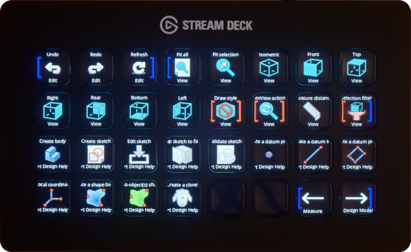
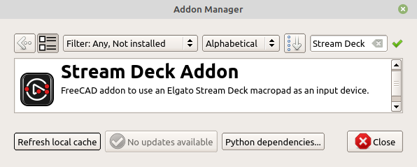
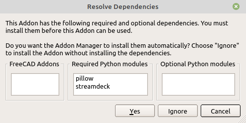
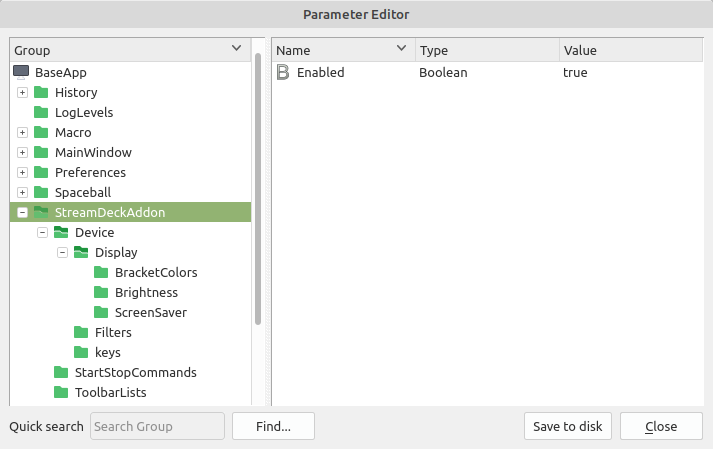

# FreeCAD Stream Deck Addon
### Version 0.1.8

* [Usage](#Usage)
* [Installation](#Installation)
* [Settings](#Settings)
* [Notes](#Notes)
* [Discussion](#Discussion)
* [License](#License)

FreeCAD addon to use an [Elgato](https://www.elgato.com) [Stream Deck](https://www.elgato.com/us/en/s/welcome-to-stream-deck) macropad as an input device.




## Usage

The toolbar tools displayed in the FreeCAD window are mirrored in real-time on the Stream Deck keys. When a key is pressed, the corresponding tool is applied as if selected in the main window.

The addon offers two layouts, selected with the **Layout_FoldersOrPages** setting. The folders layout is the default and suits Stream Decks with few keys, such as the 15-key Stream Deck.

### Folders layout

The keys are organized in four levels. **The top-left key always goes up one level**, so pressing it again and again always brings you back to the top.

1. **Workbench list** - the top level. One key per workbench, in the order FreeCAD shows them. Press one to switch to it: the Stream Deck opens that workbench's page. Here the top-left key, **Workbench**, shows the workbench grid icon and does nothing: you're at the top.
2. **Workbench page** - one key per toolbar, with the icon of the toolbar's first tool. The current workbench's toolbars come first, FreeCAD's standard toolbars (File, Edit, View...) after. The top-left key shows the icon and the name of the current workbench, and goes up to the workbench list. This is where the Stream Deck starts.
3. **Toolbar** - pressing a toolbar key opens the toolbar. The top-left key goes back to the workbench page and shows the name of the toolbar. The other keys are the toolbar's tools.
4. **Menu** - tools with a sub-menu have a **small triangle in the bottom-right corner**, like the drop-down buttons in FreeCAD's toolbars. **Long-press** one to **pop its menu up over the toolbar**: the tool stays where it is, in its toolbar color, the menu items take the keys after it - and the keys just before it if there aren't enough - and the rest of the toolbar is faded. Picking an item applies it and closes the menu. Pressing the tool again, or any faded key, closes the menu without doing anything. A menu with more items than keys gets its own previous / next page arrows, in the menu's color.

- Each level has its own **key background color**, so you always know where you are: black for the workbench list, dark grey for the workbench page, dark blue for a toolbar, dark yellow for a menu. Only the keys that belong to the level - workbenches, toolbars, tools, menu items - and its previous / next page arrows get the color. The top-left key going up a level and the empty keys stay black.
- **Long-press the top-left key** in a toolbar to go straight back to the workbench page.
- A level with more keys than fit - more than 14 tools in a toolbar on a 15-key Stream Deck, for example - is spread over several pages. The two keys at the bottom right then become **previous / next page** arrows, and the next page arrow shows the page number. An arrow is dimmed when there's no page in that direction.
- When new toolbars appear - when the workbench changes or a sketch is being edited - the Stream Deck shows the workbench page with them.

If the Stream Deck has dials, the dials change pages instead of the arrow keys.

### Pages layout

The layout of previous versions. The toolbar tools are organized in pages of keys. A toolbar occupies its own set of pages, and each key shows the name of its toolbar.

When a Stream Deck key representing a tool with a sub-menu is long-pressed, the tool is expanded to show the additional tools in the sub-menu. When any of the expanded sub-menu tools is long-pressed again, the sub-menu is collapsed back to a single tool. The tools with sub-menus are shown between red brackets.

Certain toolbars may be displayed on all the pages. Those tools are shown between blue brackets. Other toolbars can be excluded from the Stream Deck and never shown.

Two keys at the bottom right of the Stream Deck are used to change pages. If the Stream Deck has dials, the dials are used to change pages instead.

### Key labels

Tool and toolbar names are fitted into the keys: they're wrapped onto two lines, written slightly smaller, shortened - "Part Design Modeling Features" becomes "Modeling Features", "Constrain horizontal distance" becomes "Horizontal distance" - or, as a last resort, truncated with an ellipsis. The labels of disabled tools are greyed out.


## Installation

### Addon manager

In the FreeCAD menu, go to **Tools ▶ Addon manager** and select **Stream Deck Addon**:



Select **Install**, then install the required Python modules:



### Manual installation

Copy or clone this git repo directory in your FreeCAD addon directory. Typically:

User:
  - Linux:   `~/.local/share/FreeCAD/Mod/`
  - Windows: `%APPDATA%\FreeCAD\Mod\`
  - macOS:   `~/Library/Application Support/FreeCAD/Mod/`

System-wide:
  - Linux:   `/usr/share/freecad/Mod/`
  - Windows: `C:\Program Files\FreeCAD\Mod\`
  - macOS:   `/Applications/FreeCAD.app/Contents/Resources/Mod/`

You also need to install the following Python modules (e.g. with `python -m pip install`):

- pillow
- streamdeck

*Note: If you use a FreeCAD AppImage in Linux, the addon may not find the streamdeck or pillow package on your system. You can solve the problem by installing it directly into the directory the addon was installed in with `python -m pip install --target=<directory>`.*

### Windows-specific

The HIDAPI library must be installed for the streamdeck Python module to work correctly. To install it:

  - Download the latest `hidapi-win.zip` file from https://github.com/libusb/hidapi/releases
  - Copy the `hidapi.dll` file inside the ZIP file into `C:\Windows\System32` as administrator

### macOS-specific

The HIDAPI library must be installed for the streamdeck Python module to work correctly. Install it with [Homebrew](https://brew.sh):

```
brew install hidapi
```

or with [MacPorts](https://www.macports.org):

```
sudo port install hidapi
```

Homebrew and MacPorts install the library in a directory the dynamic linker doesn't search by default, so the addon looks for it itself in the usual places (`/opt/homebrew/lib`, `/usr/local/lib`, `/opt/local/lib`, and whatever `brew --prefix` reports). Nothing else needs configuring. If the library is missing or can't be loaded, the addon says so in the **Report view** and tells you what to do.

Make sure HIDAPI is built for the same architecture as your FreeCAD: an Apple Silicon FreeCAD needs the `arm64` HIDAPI, an Intel or Rosetta FreeCAD needs the `x86_64` one. The addon reports an architecture mismatch explicitly if it hits one.

If FreeCAD finds no HID device at all even though the Stream Deck is plugged in, go to **System Settings ▶ Privacy & Security ▶ Input Monitoring** and allow FreeCAD, then restart FreeCAD.

The addon needs exclusive access to the device, so quit Elgato's Stream Deck application before starting FreeCAD (or use the **StartStopCommands** settings below to do it automatically, e.g. `osascript -e 'quit app "Stream Deck"'`).

The Python modules are most easily installed through the Addon manager, which installs them into FreeCAD's own Python. If you install them by hand, install them into the directory the addon was installed in with `python -m pip install --target=<directory> pillow streamdeck`, because FreeCAD.app's own Python directories are code-signed and may be read-only.

### Fonts

The addon labels the Stream Deck keys with a TrueType font found on the system. It tries the usual font of the platform first - Open Sans on Linux, Arial on Windows and macOS - and falls back on the other fonts normally present, so it works out of the box everywhere. To force a particular font, drop a `.ttf` file named `OpenSans-Regular.ttf` or `DejaVuSans.ttf` into the addon's directory and it takes precedence.


## Settings

In the FreeCAD menu, go to **Tools ▶ Edit Parameters**.  All the settings to control the addon are under `BaseApp ▶ StreamDeckAddon`.



The ones you're really interested in are:

- **Enabled**

  Enable or disable the addon. When it is disabled, the Stream Deck device is fully released and usable by other applications while FreeCAD is running.

- **Device ▶ Display ▶ Layout_FoldersOrPages**

  `Folders` (the default) or `Pages`. See [Usage](#Usage).

- **Device ▶ Display ▶ WorkbenchSwitcher**

  Show the workbenches on the Stream Deck to switch between them (the default), in place of FreeCAD's own Workbench toolbar. In the folders layout, the workbench list is the top level, above the workbench page. When this is off, the workbench page is the top level. In the pages layout, the workbenches get pages of their own. The list is the one FreeCAD's workbench selector shows: to shorten it, disable the workbenches you don't use on the **Workbenches** page of FreeCAD's preferences.

- **Device ▶ Filter ▶ UseDeviceType**

  The type of the Stream Deck device you want to use if more than one device is connected. E.g. `Stream Deck XL`. Leave blank to use a device of any type.

- **Device ▶ Filter ▶ UseDeviceSerial**

  The serial number of the Stream Deck device you want to use if more than one device is connected. E.g. `A00NA325307HF5`. Leave blank to use a device with any serial number.

- **StartStopCommands ▶ ExecuteShellCommandWhenStarting**

  Shell script to run when starting. Useful to kill another Stream Deck application such as streamdeck-ui and release the Stream Deck device for use by this addon. E.g. `killall streamdeck`. Leave blank to disable.

- **StartStopCommands ▶ ExecuteShellCommandWhenStopping**

  Shell script to run when stopping. Useful to restart another Stream Deck application such as streamdeck-ui after the Stream Deck device has been releases by this addon. E.g. `streamdeck --no-ui &`. Leave blank to disable.

- **ToolbarLists ▶ ToolbarsExcluded_CommaSeparated**

  Comma-separated list of names of toolbars you never want displayed on the Stream Deck regardless of whether they're enabled in the main window, to reduce clutter. E.g. `Help,Navigation`. Leave blank to display all the toolbars on the Stream Deck.

- **ToolbarLists ▶ ToolbarsOnEveryPage_CommaSeparated**

  Comma-separated list of names of toolbars you want repeated on all the Stream Deck pages, so they're always available regardless of the particular toolbar page you're in.  E.g. `Edit,View`.  Note that those permanently-displayed toolbars are laid out on the Stream Deck in the order they're listed.

  In the folders layout, the tools of those toolbars are shown directly on the home page, before the toolbar keys, instead of in a toolbar of their own.

  If your Stream Deck has enough keys - Stream Deck XL for example - you can have more permanently-displayed toolbar tools without multiplying the number of pages.

  If your Stream Deck has fewer keys, you may want to have fewer permanently-displayed toolbar tools to free up more keys per page.

  Leave blank if you don't want any toolbars repeated on all the pages.

- **Display ▶ MarkColors ▶ LongPressMenuTriangle**, **NestedFolderCorner**

  Folders layout only. Colors of the small triangle that marks the tools with a sub-menu, and of the small folder in the top-right corner of a toolbar key placed inside another folder. The toolbar keys of the home page have no mark. Any color name or `#RRGGBB` value Pillow understands, e.g. `WhiteSmoke` or `#E8B923`.

- **Display ▶ LevelColors ▶ WorkbenchList**, **WorkbenchPage**, **ToolbarPages**, **MenuPages**

  Folders layout only. Background color of the keys that belong to each level, including its previous / next page arrows - the top-left key going up a level and the empty keys stay black: the workbench list (default `#000000`, black), the workbench page (default `#2e3436`, dark grey), the toolbar pages (default `#14305a`, dark blue) and the long-press menu pages (default `#3d3000`, dark yellow). Keep them dark so the icons and the labels stand out. Any color name or `#RRGGBB` value Pillow understands; anything else means black.

- **Display ▶ BracketColors ▶ ExpandableTools**, **PageNavigationKeys**, **ToolbarsOnEveryPage**

  Pages layout only. Colors of the brackets that mark the tools with a sub-menu, the page navigation keys and the tools of the toolbars repeated on every page. Any color name Pillow understands, e.g. `Gold` or `DodgerBlue`. Leave blank for no brackets.

- **Display ▶ Brightness ▶ BrightnessPercent**

  How bright the Stream Deck's display should be. Percentage from 0% to 100%.

- **Display ▶ ScreenSaver ▶ Enabled**  
  **Display ▶ ScreenSaver ▶ FadeWhenUserInactiveForSeconds**  
  **Display ▶ ScreenSaver ▶ FadeToBrightness**  
  **Display ▶ ScreenSaver ▶ FadeTimeSeconds**  

  Stream Deck screen saver settings.

All setting changes take effect immediately. You don't need to restart FreeCAD.


## Notes

- The addon needs exclusive access to the Stream Deck device. It cannot coexist
  with Elgato's Stream Deck software on Windows or macOS, or with streamdeck-ui
  on Linux. Either the addon has control of the Stream Deck device or the other
  application does, but not both at the same time.

- Tested with FreeCAD 0.22 on Linux and Windows, with a Stream Deck Mk2, Stream Deck XL and Stream Deck +. It may or may not work with other models. macOS support was added in 0.1.8.

- This software is still under development. Please bear with me as I make it nicer 🙂


## Discussion

Feel free to give feedback, suggestions or discuss issues in the [official FreeCAD forum thread](https://forum.freecad.org/viewtopic.php?t=85871).


## License

GPL-3.0
